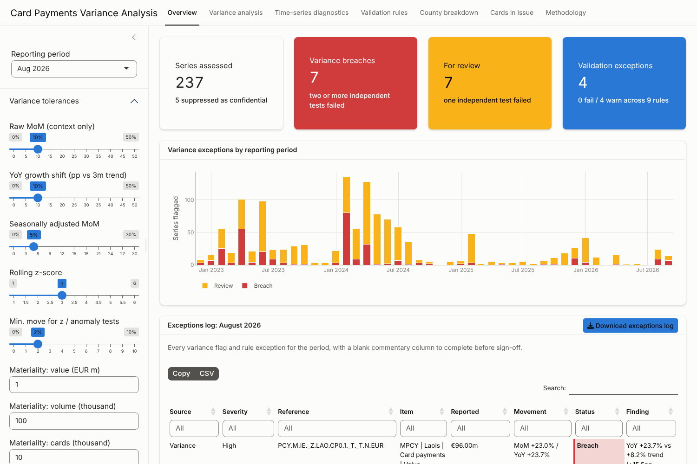
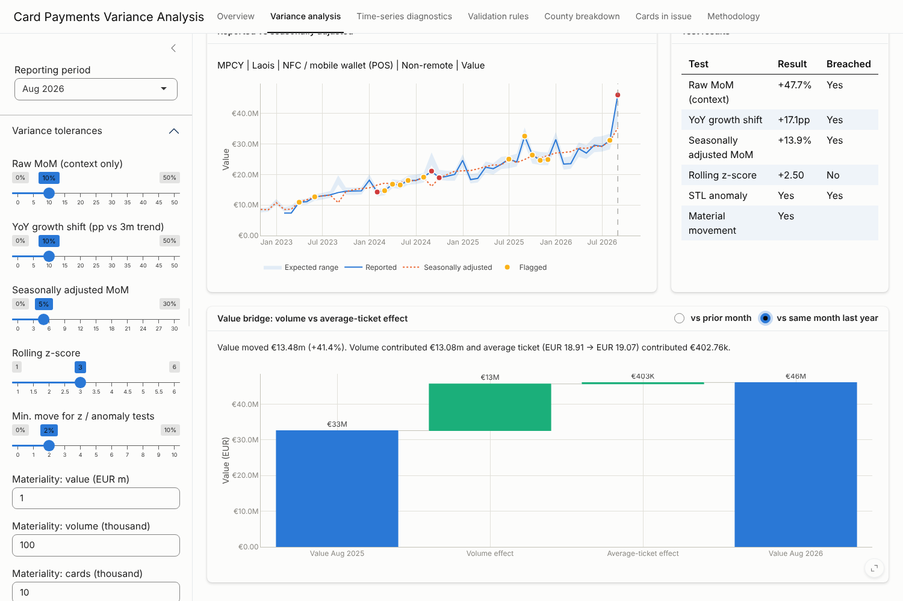
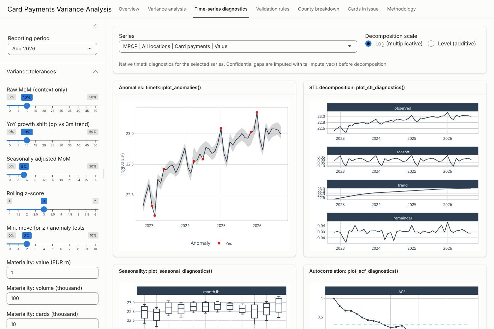

# cardsvariance

<!-- badges: start -->
<!-- badges: end -->

A Shiny application, built as an R package, for **pre-submission
validation of card payments regulatory data**. It runs the checks a
regulatory reporting team applies before filing: period-on-period variance
analysis with seasonal adjustment and anomaly detection (via
[timetk](https://business-science.github.io/timetk/)), hierarchy and
cross-return reconciliation rules, a value/volume bridge, and an exportable
exceptions log for commentary and sign-off.

The bundled data are the Central Bank of Ireland card statistics returns
from October 2022 to August 2026:

| Return | Content | Series | Rows |
|---|---|---:|---:|
| MPCI | Cards in issue (debit, credit) | 2 | 94 |
| MPCP | Card payments & ATM withdrawals by terminal location and channel | 24 | 1,128 |
| MPCY | Card payments, contactless, NFC & ATM withdrawals by county | 216 | 10,152 |

## Quick start

```r
# 1. Restore the exact package versions recorded in renv.lock
renv::restore()

# 2. Load and launch
devtools::load_all()
run_app()
```

To deploy to Posit Connect or shinyapps.io, use the root-level `app.R`.

## What the app does



| Tab | Purpose |
|---|---|
| **Overview** | Headline counts for the selected period, exception history and a downloadable **exceptions log** with a blank commentary column. |
| **Variance analysis** | Every series for the period with MoM, YoY, YoY shift, seasonally adjusted MoM, z-score, RAG status and a plain-English reason. Select a row to chart it against its seasonally adjusted series and expected range, and to bridge the value movement into **volume** and **average-ticket** effects. |
| **Time-series diagnostics** | Native timetk diagnostics for any series: `plot_anomalies()`, `plot_stl_diagnostics()`, `plot_seasonal_diagnostics()`, `plot_acf_diagnostics()`. |
| **Validation rules** | Nine rules (VR01–VR09) with a per-period summary, an exceptions heatmap over time and drill-down detail. |
| **County breakdown** | County YoY growth coloured by status, share of national total and county-allocation coverage. |
| **Cards in issue** | Payments per card (a cross-return ratio) and cards-in-issue variances. |
| **Methodology** | How each test works and what it finds in the bundled data. |

All tolerances are set in the sidebar. You can also **upload draft MPCI,
MPCP or MPCY extracts**; the return type is detected from the header, so a
draft submission can be validated before filing.





## Variance methodology

Escalation needs agreement between independent tests, so seasonal patterns
and structural growth don't drown out the real exceptions:

| Test | Implementation |
|---|---|
| Raw MoM | `timetk::tk_augment_lags()`. Context only: December always jumps. |
| YoY growth shift | YoY growth less its trailing 3-month mean. Steady +30% growth in mobile wallets isn't an error; a sudden change in it is. |
| Seasonally adjusted MoM | STL on the log scale (multiplicative seasonality) via `timetk::anomalize()`. |
| Rolling z-score | MoM change against the previous 12 months, via `timetk::slidify_vec()`. |
| STL anomaly | IQR on the STL remainder, via `timetk::anomalize()`. |

**Breach** = two or more independent tests fail; **Review** = one fails.
Materiality floors and a minimum percentage move stop trivial series from
flagging. Confidential (suppressed) cells are reported as *Not assessed*.
They are imputed with `timetk::ts_impute_vec()` only to keep the
decomposition running, and never assessed.

## Validation rules

| ID | Rule |
|---|---|
| VR01 | MPCP all locations = domestic + abroad |
| VR02 | MPCP all channels = remote + non-remote |
| VR03 | MPCY counties ≤ national total; unexplained residuals flagged |
| VR04 | MPCY NFC ≤ contactless ≤ all card payments |
| VR05 | MPCY national total reconciles to MPCP domestic |
| VR06 | Average transaction value in a plausible band, stable YoY |
| VR07 | Completeness, confidentiality-flag consistency, duplicates |
| VR08 | No negative values |
| VR09 | Card payments per card in issue (MPCP ÷ MPCI) plausible and stable |

## Highlights from the bundled data

- **March 2023**: debit cards in issue rose 28% and payment volumes rose
  37%, while payments per card rose only 12%. This points to a change in the
  reporting population. The variance engine also flags the **base effect**
  a year later, in March 2024.
- **August 2026, Laois**: card, contactless and NFC payments all jump
  23–56% month on month with no national move. This is flagged as a Breach
  for querying with the reporting agent.
- **VR05**: MPCY and MPCP domestic totals agree to within a few thousandths
  of a percent in most months. October 2022 is the outlier, at 0.09%.

## Using the functions directly

```r
library(cardsvariance)

data <- load_cards_data()                      # or cards_data
metrics <- compute_variance_metrics(data)      # lags, STL, anomalies
flagged <- flag_variances(metrics, variance_thresholds(sa_pct = 0.05))
period_variances(flagged, "2026-08-31")

validation <- run_validation(data)
summarise_validation(validation, "2026-08-31")

exceptions_log(flagged, validation, "2026-08-31") |>
  readr::write_csv("exceptions_2026_08.csv")

value_volume_bridge(data, "PCP.M.IE._Z.W0.CP0.1._T._T.PCS_ALL._Z._X._Z.N",
                    "2025-12-31", compare = "mom")
```

## Project structure

```
R/                 package code: import, variance engine, validation rules,
                   plots, Shiny UI/server and modules (mod_*.R)
inst/extdata/      raw CBI CSV extracts
inst/app/          methodology page
data-raw/          script that builds data/cards_data.rda
tests/testthat/    unit tests (engine, rules, Shiny server via testServer)
dev/               usethis scaffolding script and development loop
app.R              deployment entry point
renv.lock          pinned package versions
```

Built with `usethis` (scaffolding), `devtools` (load/document/test/check),
`renv` (reproducible environment) and `testthat`.
